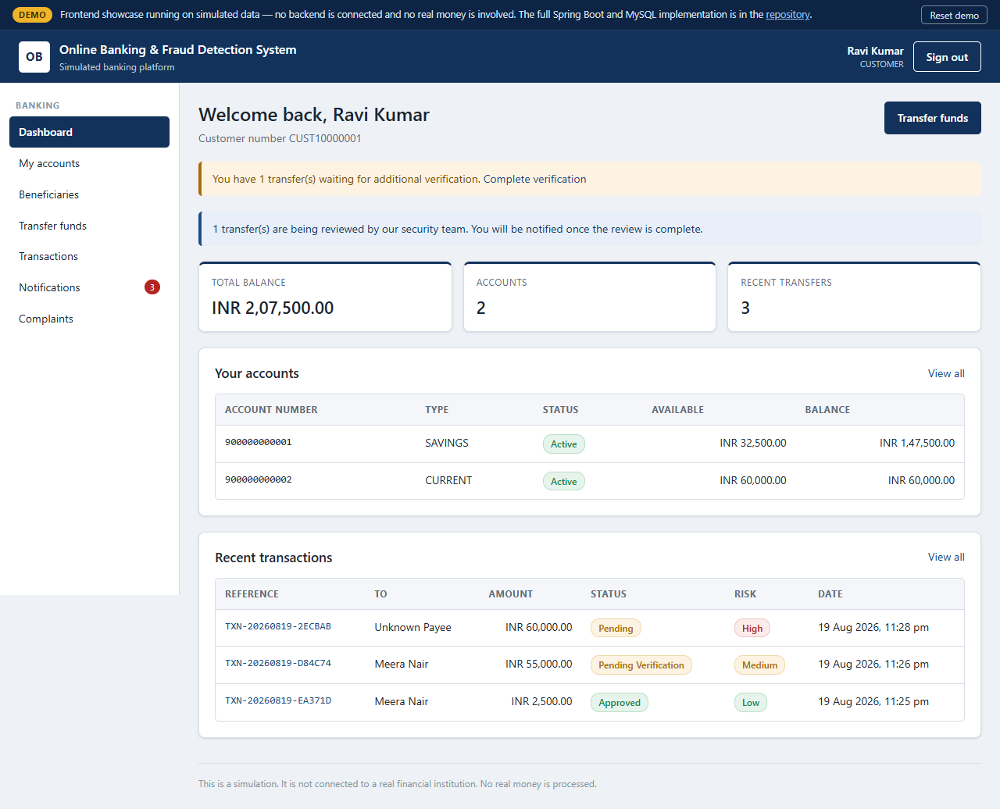
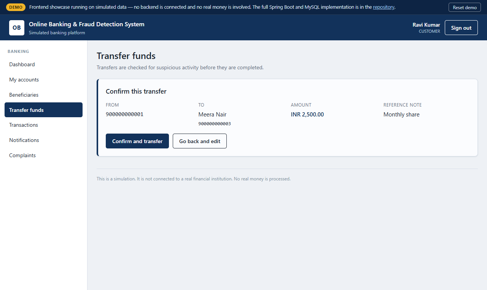
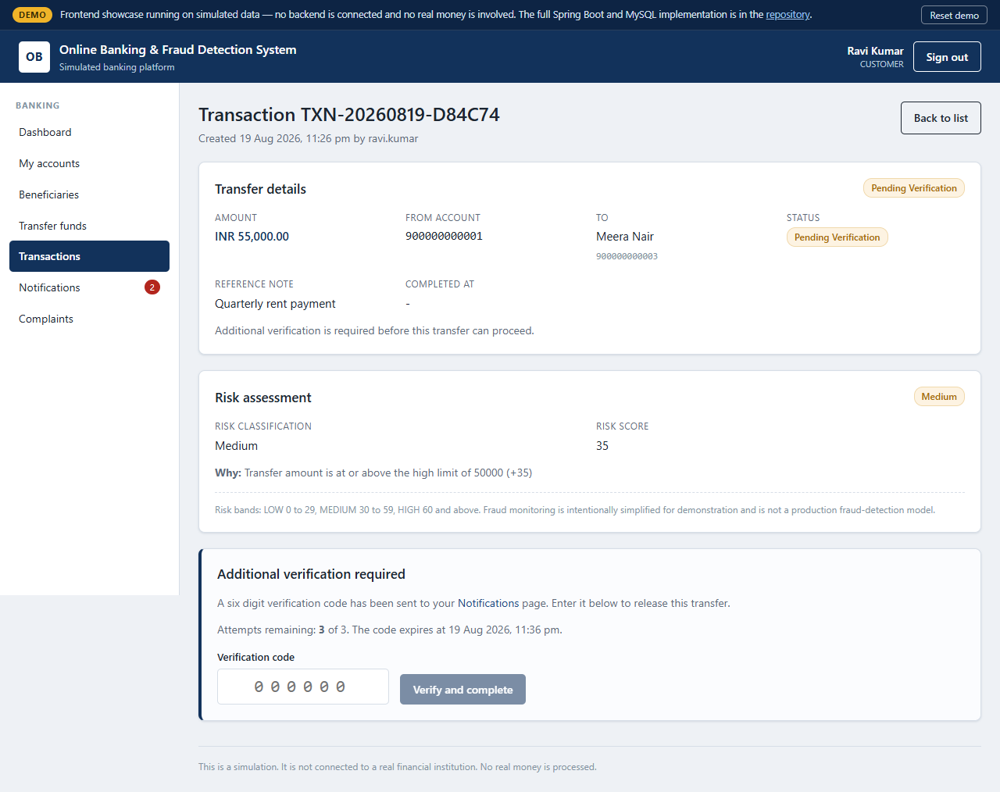
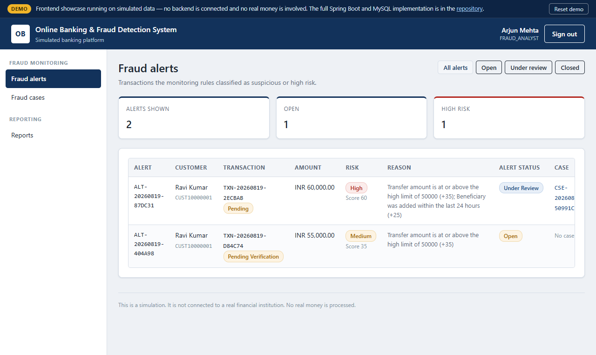
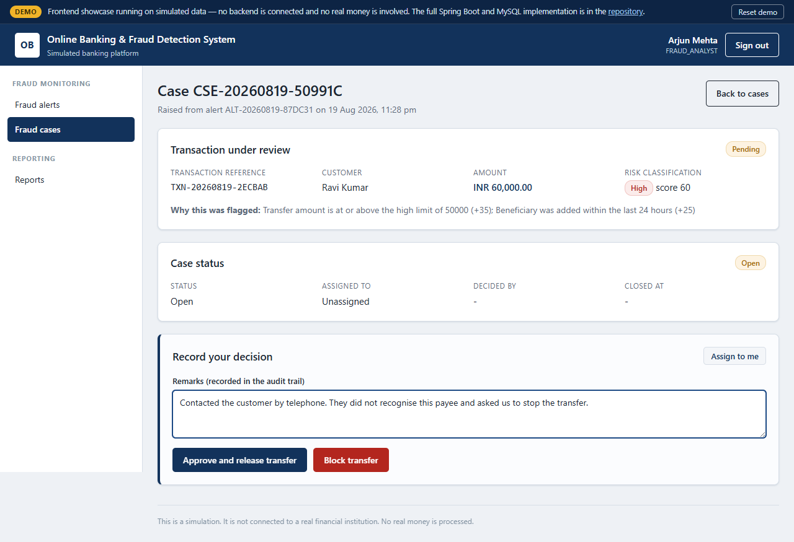
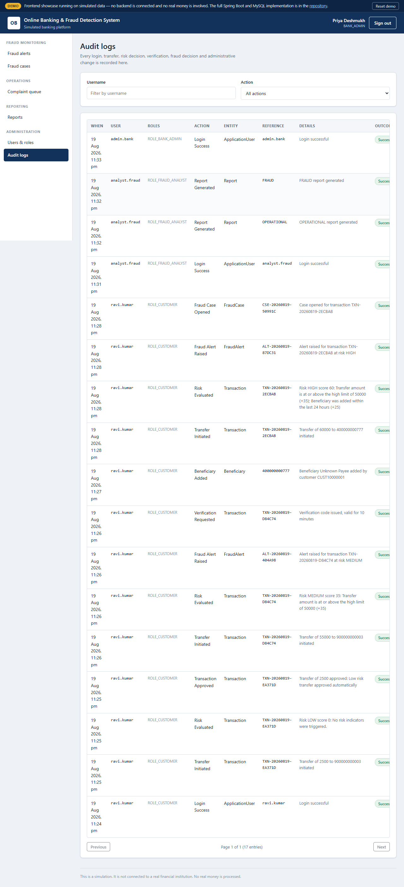
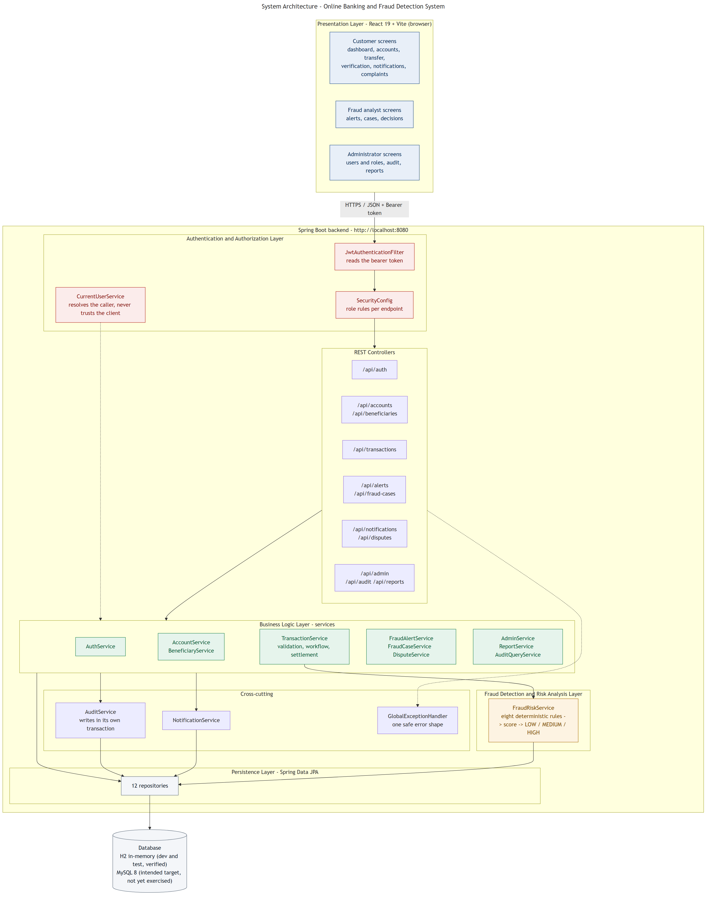
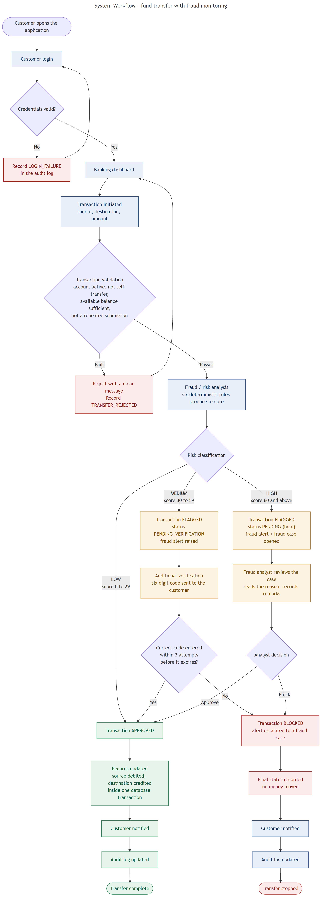

# Online Banking & Fraud Detection System

A full-stack online banking simulation with secure authentication, transaction management,
rule-based fraud-risk analysis, alerts, verification workflows, case review, administration and
audit logging.

[](https://github.com/anmol-228/online-banking-fraud-detection-system/actions/workflows/ci.yml)
[](https://github.com/anmol-228/online-banking-fraud-detection-system/actions/workflows/pages.yml)


### ▶ [Live Demo](https://anmol-228.github.io/online-banking-fraud-detection-system/)

The public demo runs in **frontend showcase mode using simulated data** — everything happens in the
browser, with no backend deployed. This repository also contains the complete Spring Boot backend
and database-backed full-stack implementation for local development.

> **This is a simulation.** It is not connected to any real financial institution and processes no
> real money. All data is fictional.

---

## Overview

Online banking has two problems that pull against each other. Transfers need to be fast and simple,
and they also need to be safe — which means some of them must be stopped and questioned. This
project implements that tension end to end.

Every transfer is scored by a deterministic rule engine **before** it settles. Low-risk transfers
complete immediately. Medium-risk transfers are held until the customer enters a verification code.
High-risk transfers are held until a human analyst decides. Money only ever moves when a transfer
reaches `APPROVED`, and the debit, the credit and the status change happen inside a single database
transaction — so a transfer can never report success while the account update failed.

Every consequential action, including rejected ones, is written to an append-only audit trail.

Three real defects were found by running the whole system, not by the unit tests — each
root-caused, fixed, and covered by a regression test written so it could fail again. The third
was found by re-checking the lesson the second one taught, which is the more useful half of the
story. Full write-up in [Testing](#testing).

---

## Key Features

**Customer**
- Registration and login with BCrypt-hashed passwords and stateless JWT sessions
- Account details, balance enquiry with a separate **available balance** that excludes pending transfers
- Beneficiary management (add, view, deactivate)
- Fund transfers with server-side validation, confirmation step and duplicate protection
- Additional verification when a transfer is held for risk
- Transaction history with status and risk classification
- In-app notifications and complaint/dispute submission

**Fraud monitoring**
- Eight-rule deterministic risk engine, scored before the transaction is persisted
- Risk classification: **LOW 0–29 · MEDIUM 30–59 · HIGH 60+**
- Automatic fraud alerts with the exact rules that fired, in words
- Six-digit verification challenge (hashed, expiring, attempt-limited)
- Fraud case review: assign, record mandatory remarks, approve or block

**Bank staff**
- Fraud analyst: alert dashboard with filters, case list, case decisions
- Operations officer: complaint queue and outcome recording
- Administrator: user and role management with self-lockout guards
- Audit trail viewer with filtering by user and action
- Operational and fraud reports counted directly from stored data

---

## Screenshots

| Customer dashboard | Fund transfer |
|---|---|
|  |  |

| Transfer held for verification | Fraud analyst alerts |
|---|---|
|  |  |

| Fraud case review | Audit trail |
|---|---|
|  |  |

All screenshots are in [`docs/screenshots/`](docs/screenshots/).

---

## Architecture

```text
React Frontend  (React 19 + Vite, role-filtered navigation)
      ↓  HTTPS / JSON + Bearer token
Spring Boot REST API
      ↓
Authentication & Authorization  (JWT filter, per-endpoint role rules, ownership checks)
      ↓
Service / Domain Layer  (accounts, beneficiaries, transactions, cases, disputes, admin)
      ↓
Fraud Risk Engine  (eight deterministic rules → score → LOW / MEDIUM / HIGH)
      ↓
Spring Data JPA
      ↓
H2 in-memory (dev/test)  |  MySQL 8.4 (persistent; schema owned by versioned Flyway migrations)

Cross-cutting: notification service, append-only audit logging, centralised error handling
```

A layered **modular monolith** — deliberately not microservices. A transfer that debits one account
and credits another is exactly the case where a single database transaction is the correct answer,
and that is only available inside one service.



More detail: [Architecture](docs/architecture.md) · [Database design](docs/database-design.md) ·
[API](docs/api.md)

---

## Technology Stack

**Frontend** — React 19, Vite 6, React Router 7, Axios, hand-written CSS (no component library)

**Backend** — Java 21 language level, Spring Boot 3.5, Spring Web, Spring Security, Spring Data JPA,
Bean Validation, JJWT

**Database** — H2 in-memory for development and the automated tests. MySQL 8.4 for a persistent
installation: the schema is created and upgraded only by the separate Flyway migrator, and the running
service uses a database account that can read and write rows but cannot alter tables. The full test
suite also runs against a real MySQL (see [Testing](docs/testing.md)).

**Tooling** — Maven, npm, GitHub Actions, JUnit 5, MockMvc, Mockito, AssertJ

---

## Fraud Risk Engine

A **transparent, deterministic, rule-based risk-scoring engine**. Each rule that fires contributes
a fixed number of points; the total maps to a band. The same transfer against the same history
always produces the same score, which is what makes it testable and explainable.

| Rule | Fires when | Points |
|---|---|---|
| Very high amount | amount ≥ 100,000 | 50 |
| High amount | amount ≥ 50,000 | 35 |
| New beneficiary | payee added within 24 hours | 25 |
| Unregistered payee | destination not in the saved payee list | 20 |
| Rapid transfers | ≥ 3 transfers in 10 minutes | 20 |
| Repeated failed verification | ≥ 2 failures in 24 hours | 20 |
| Balance drain | > 80% of the account balance | 15 |
| Unusual hour | between 00:00 and 05:00 | 10 |

| Score | Classification | Outcome |
|---|---|---|
| 0 – 29 | **LOW** | Approved immediately |
| 30 – 59 | **MEDIUM** | Held; customer must enter a verification code |
| 60+ | **HIGH** | Held; fraud analyst decides |

Every threshold is a configuration property and can be tuned without recompiling.

**This is not machine learning and is not marketed as such.** It does not learn from past decisions.
It is a rule engine, and its transparency is the point: the alert, the analyst screen, the customer
screen and the audit entry all state the same reason in the same words.

Detail: [Fraud risk engine](docs/fraud-risk-engine.md)

---

## System Workflow

```text
Login → Authentication → Dashboard → Transfer initiated → Validation → Risk analysis
                                                                            │
        ┌───────────────────────────────┬───────────────────────────────────┘
        │                               │
     LOW risk                     MEDIUM risk                        HIGH risk
        │                               │                                │
   Approved                    Held: verification code            Held: fraud case
   Money moves                        │                                │
   Customer notified          correct → Approved              analyst → Approved
   Audit written              3 failures → Blocked            analyst → Blocked
                                       │                                │
                             Final status recorded → Customer notified → Audit written
```



---

## Project Structure

```text
.
├── backend/                    Spring Boot API
│   └── src/main/java/com/sepro/obfds/
│       ├── config/  controller/  service/  fraud/
│       ├── notification/  audit/  security/
│       └── repository/  entity/  dto/  exception/
├── frontend/                   React + Vite (19 screens)
│   └── src/
│       ├── api/                axios client + endpoint map
│       ├── services/           banking service abstraction (API + showcase adapters)
│       ├── auth/  components/  pages/  utils/
├── docs/                       architecture, database, API, testing, security, deployment
│   ├── diagrams/               11 Mermaid sources + rendered PNGs
│   └── screenshots/
├── scripts/verify_runtime.py   end-to-end verification against a running instance
└── .github/workflows/          CI + GitHub Pages deployment
```

---

## Running Locally

### Prerequisites

JDK 21+ · Maven 3.8+ · Node.js 18+ · npm 9+ · MySQL 8 *(optional — H2 is the default)*

### Backend

```bash
cd backend
mvn spring-boot:run
```

Runs on **http://localhost:8080**. Verify with `curl http://localhost:8080/actuator/health` →
`{"status":"UP"}`.

### Database

No installation needed by default: the `dev` profile uses an in-memory H2 database, seeded with
fictional demo data on every start.

To use MySQL instead (a persistent, single-machine installation), the schema is created by the
migrator, never by the application, and two database accounts are used: one for the migrator (DDL) and
one, with `SELECT/INSERT/UPDATE/DELETE` only, for the running service.

```bash
# 1. create the schema with the migrator (DDL account), then start the service as the DML-only account
java -cp obfds-backend.jar -Dloader.main=com.sepro.obfds.migrate.Migrator \
     org.springframework.boot.loader.launch.PropertiesLauncher migrate        # needs MIGRATE_URL/USERNAME/PASSWORD
SPRING_PROFILES_ACTIVE=mysql,localdemo MYSQL_USERNAME=... MYSQL_PASSWORD=... java -jar obfds-backend.jar
```

The `localdemo` profile binds to `127.0.0.1`, seeds the fictional demo data and keeps a random
per-installation signing secret in a file outside the repository. Without it (or `public`), the service
refuses to start: it has no secret, seeds nobody and accepts no registrations by default. The step-by-step
Windows runbook, including backups and a restore proof, is in **[docs/operations.md](docs/operations.md)**
(scripts in [`ops/local-windows`](ops/local-windows)).

### Frontend

```bash
cd frontend
npm install
npm run dev
```

Runs on **http://localhost:5173** and talks to the backend on 8080.

To build the browser-only showcase locally:

```bash
VITE_APP_MODE=showcase npm run build && npm run preview
```

---

## Demo Accounts

Fictional credentials seeded for local development and the browser demo. They grant access to
nothing outside this application. They exist only in `dev` and in the loopback-only `localdemo`
installation: the service **refuses to start** with these fixed passwords on anything reachable from
outside (`public` profile or any non-loopback bind), where passwords come from the environment instead.

| Role | Username | Password |
|---|---|---|
| Customer | `ravi.kumar` | `Customer@123` |
| Customer | `meera.nair` | `Customer@123` |
| Bank Administrator | `admin.bank` | `Admin@123` |
| Fraud Analyst | `analyst.fraud` | `Analyst@123` |
| Operations Officer | `ops.officer` | `Officer@123` |
| System Administrator | `sys.admin` | `SysAdmin@123` |

**See the fraud workflow in 60 seconds:** sign in as `ravi.kumar`, transfer **55,000** to Meera Nair
— the transfer is held as MEDIUM risk. Open **Notifications**, read the six-digit code, enter it on
the transaction page, and the transfer completes.

The live demo also has one-click role buttons on the login screen.

---

## API

Full endpoint reference with request/response shapes: **[docs/api.md](docs/api.md)**

All endpoints except `/api/auth/register`, `/api/auth/login` and `/actuator/health` require
`Authorization: Bearer <token>`.

| Group | Purpose |
|---|---|
| `/api/auth` | Registration, login, current profile |
| `/api/accounts` | Account details and balance enquiry |
| `/api/beneficiaries` | Payee management |
| `/api/transactions` | Transfers, history, verification |
| `/api/alerts` · `/api/fraud-cases` | Fraud monitoring and review |
| `/api/notifications` · `/api/disputes` | Customer messaging and complaints |
| `/api/admin` · `/api/audit` · `/api/reports` | Administration, audit trail, reporting |

Every failure returns the same JSON shape with a stable machine-readable `code`.

---

## Testing

```bash
cd backend  && mvn clean verify      # compile, run all tests (two JVMs), build the JAR
cd frontend && npm run test:policy && npm run test:parity && npm run build
```

**206 automated backend tests**, covering unit, integration, security, concurrency and failure-handling
levels: 163 in the default execution and 43 in a separate execution that commits real rows and races real
transactions. On H2 all pass (12 MySQL-only migration tests are skipped); against a **real MySQL 8.4** at its
default isolation all 206 run and pass. CI also asserts that the important test classes actually ran. The
frontend has policy and rule-parity scripts (36 + 168 checks) and is verified by building both modes; there is no
component-level frontend test suite. Detail: [Testing](docs/testing.md).

| Level | Focus |
|---|---|
| Unit | The fraud rule engine in isolation, with mocked repositories |
| Integration | Controller → security → service → repository → database, via MockMvc |
| Security | Unauthenticated access, forged tokens, wrong-role access, cross-customer isolation |
| Failure handling | Database outage returns 503 with no internal detail leaked |

There is also an end-to-end script that exercises the **running** application over real HTTP:

```bash
python scripts/verify_runtime.py     # expects a freshly started backend
```

Three real defects were found by running the system rather than by the unit tests — a velocity
rule that counted a transfer against itself; audit entries lost on rejected paths because a
self-invocation bypassed the Spring proxy; and failed verification attempts that were never
counted, because the attempt was recorded and then rolled back by the very exception that
reported it. All three are fixed and each has a regression test written specifically so it
*could* fail again. The third is the instructive one: it was hidden by the same test-managed
transaction that hid the second, in a neighbouring code path, and survived the write-up of that
lesson. Details: [Testing](docs/testing.md).

Every requirement traces from specification to implementation to test — see
[Requirement Traceability](docs/requirement-traceability.md).

---

## Security Considerations

Implemented in this project:

- **Password hashing** — BCrypt; no password is ever stored or logged in readable form
- **Verification codes hashed too** — they grant a financial action, so they are treated like passwords
- **Stateless JWT authentication** with signature and expiry verification on every request, and a database lookup of the user on every request: a disabled user, a deleted user or a changed role takes effect on the very next call (the token's own role claim is ignored)
- **Fail-closed start-up** — the service refuses to start with the published development secret, fixed demo passwords, open registration, a localhost CORS origin or an unsafe thread/connection-pool ratio on anything reachable from outside
- **Login abuse controls** — bounded per-(username, client) lockout with growing delay and `429 Retry-After`, a per-address ceiling, input length limits checked before the password hash, and one identical `401` for wrong password and disabled account
- **Closed or invite-only registration** for a public deployment (it hands out a funded account)
- **Role-based authorization** declared per endpoint, with `anyRequest().authenticated()` as the default, so a new endpoint is protected unless explicitly opened
- **Ownership checks** — every query is scoped to the caller resolved from the security context, never to a client-supplied identifier; a request for another user's resource returns `404` rather than `403` so it does not confirm existence
- **Server-side validation** on every input, independent of the browser
- **Safe error responses** — actionable failures get a specific code, internal faults get a generic message and the detail stays in the server log
- **Restricted CORS** to a configured origin, never a wildcard
- **Audit logging** written in its own transaction so rejected attempts still leave evidence
- **Serialised money movement** — a transfer, a verification, a cancellation and an analyst decision each take row locks in one fixed order (case, then accounts by id), so concurrent requests cannot over-reserve funds, double-spend or deadlock; the version column on accounts remains as a second line of defence
- **Safe retries** — an idempotency key is honoured only for its owner and for the same transfer (source, destination, amount): a retry after a timeout returns the original, another customer's key returns `409` with no data, and a different key is a different transfer
- **Evidence only, never an automatic report** — a held high-risk transfer can only be released by an analyst; the customer's statement ("mine" / "not mine") is recorded as evidence and never moves money; the system builds a minimal evidence file with no free text (account numbers masked, analyst remarks omitted) and a mail *draft* to a pre-approved team mailbox and sends nothing itself

Detail: [Security](docs/security.md)

---

## Limitations

- Fraud detection is a simplified rule engine. **False positives and false negatives are both possible**, and no detection system identifies every fraudulent transaction.
- No real banking integration and no real-money processing. All data is fictional.
- The public demo is frontend-only and uses simulated data held in the browser.
- The backend and database are **not** publicly deployed yet.
- A signed token is not stored server-side, but because every request re-reads the user, disabling a login (or removing a role) stops that user immediately. Rotating the signing secret signs everyone out.
- Transfers on one account are serialised, and the service is tuned to a small, fixed worker pool (threads are held to half the database connections). That bounds throughput; it has been exercised with bursts larger than the pool but not load-tested for sustained traffic.
- Velocity (`RAPID_TRANSFERS`) is counted per customer when a transfer is assessed. Transfers started at the same instant from *different* accounts of one customer are not serialised against each other and can evade that one rule; money stays exact on every account.
- Flyway 11.7 officially tests MySQL up to 8.1; the migrations here are verified on MySQL 8.4.13 (empty database, populated database, rollback), but that is a verified combination rather than a vendor-certified one.
- The login throttle and its counters live in memory: a restart clears them.
- Production deployment would require security assessment, load testing and operational hardening that have not been performed.

---

## Future Improvements

- Full-stack cloud deployment — see the [deployment roadmap](docs/full-stack-deployment-roadmap.md)
- A genuine out-of-band channel (SMS/email) for verification codes, and, if ever wanted, a server-originated notification through an authenticated provider (today the system only prepares a draft for a person to send)
- Containerised deployment and a richer CI/CD pipeline
- Load-testing concurrency under sustained contention, not just a single race
- Deeper reporting and analytics over the audit trail

---

## License

No license has been chosen for this repository yet, so default copyright applies. If you would like
to use any part of it, please open an issue.
