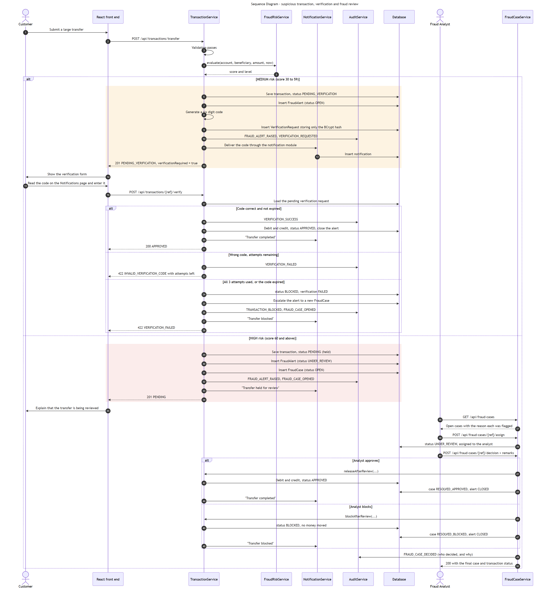

# Fraud Risk Engine

A transparent, deterministic, rule-based risk-scoring engine.

> **This is not machine learning.** It does not learn from past decisions, it has no model to
> train, and it is not presented as predictive AI. It is a rule engine, and its transparency is the
> point.

---

## 1. Why rules rather than a model

Three reasons, in order of importance:

1. **Explainability.** When a transfer is held, the customer sees exactly why, the analyst sees
   exactly why, and the audit entry records exactly why — in the same words. A scored model would
   give a number without a sentence.
2. **Determinism.** The same transfer against the same history always produces the same score. That
   is what makes the behaviour testable: a unit test can assert the score is 60, not "roughly high".
3. **No training data.** This is a simulated bank. There is no labelled history of real fraud to
   learn from, and inventing one would make any model meaningless.

---

## 2. The rules

Implemented in `FraudRiskService` (backend) and mirrored in `showcaseFraudRules.js` (browser demo),
with identical points and thresholds.

<!-- This table is machine-checked: FraudRuleSpecificationTest parses it and fails if a point value
     here differs from what the engine does. Edit the table and the code together. -->
<!-- rules:begin -->
| Rule | Fires when | Points | Why it is a signal |
|---|---|---|---|
| `VERY_HIGH_AMOUNT` | amount ≥ 100,000 | 50 | Large amounts carry the largest loss |
| `HIGH_AMOUNT` | 50,000 ≤ amount < 100,000 | 35 | Unusually large for an ordinary customer |
| `NEW_BENEFICIARY` | payee is saved, and was saved less than 24 hours ago | 25 | Adding a payee then immediately sending money is a common pattern |
| `UNREGISTERED_PAYEE` | destination is not an active saved payee of the customer | 20 | No established relationship with the destination |
| `RAPID_TRANSFERS` | ≥ 3 earlier transfers by this customer in the last 10 minutes | 20 | Rapid sequences suggest automation rather than a person |
| `REPEATED_FAILED_VERIFICATION` | ≥ 2 failed verifications in the last 24 hours | 20 | Someone is failing challenges they should be able to pass |
| `BALANCE_DRAIN` | amount > 80% of the account's ledger balance | 15 | Emptying an account is unusual for a routine payment |
| `UNUSUAL_HOUR` | initiated from 00:00 to 04:59 (Asia/Kolkata) | 10 | Weak alone; meaningful in combination |
<!-- rules:end -->

Maximum reachable score: **140** (50 + 25 + 20 + 15 + 10 + 20: a very large transfer to a payee saved
minutes ago, during a burst of transfers, draining the account, at night, after failed
verifications).

Two pairs are mutually exclusive, so a transfer never scores both members:

- **Amount:** `VERY_HIGH_AMOUNT` *or* `HIGH_AMOUNT` (or neither).
- **Payee:** `NEW_BENEFICIARY` *or* `UNREGISTERED_PAYEE` (or neither). A payee that is saved and older
  than 24 hours scores nothing.

### Exact boundary semantics

Every comparison below is what the code does, and each is pinned by a test
(`FraudRuleSpecificationTest`).

| Rule | Boundary behaviour |
|---|---|
| Amount | Lower bounds are **inclusive**: exactly 50,000 is `HIGH_AMOUNT`; exactly 100,000 is `VERY_HIGH_AMOUNT`; 49,999.99 scores nothing. |
| `NEW_BENEFICIARY` | The payee must have been saved **strictly after** (now − 24 h). A payee saved exactly 24 hours ago is *not* new; one saved 23 h 59 min 59 s ago is. |
| `RAPID_TRANSFERS` | Counts this customer's **earlier** transfers (every status, every account) created **strictly after** (now − 10 min). The transfer being assessed is not counted. 2 earlier transfers: no; 3: yes. |
| `REPEATED_FAILED_VERIFICATION` | 1 failure: no. 2 failures in the last 24 hours: yes. |
| `BALANCE_DRAIN` | **Strictly greater** than 0.80 × the ledger balance: an amount of exactly 80% does not fire; 80% plus one paisa does. A balance of zero or less never fires. Funds held for other pending transfers are *not* subtracted. |
| `UNUSUAL_HOUR` | The hour of day **in the configured zone** (`Asia/Kolkata`, not the server's own zone) is in [00, 05): 00:00 fires, 04:59 fires, 05:00 and 23:59 do not. |

### What is configurable and what is not

| Configurable (`obfds.fraud.*`) | Fixed in code |
|---|---|
| the two amount limits, the payee-age hours, the velocity count and window, the drain fraction, the unusual-hour window and zone, both score thresholds | the **eight point values**, the 24-hour window and the count of 2 for failed verifications |

The point values are deliberately constants: changing a weight changes what the documented scores
mean, so it is a code change that goes through review and updates this table.

### Eight rules, six methods

Reading `FraudRiskService` you will count six private methods, not eight. The two counts describe
different things and both are correct. The table above counts **scored rules**: one row per risk
factor that can be raised, each with its own code and its own point value. The code groups those
eight rules into six checks, because two of the checks choose between a mutually exclusive pair
rather than raising a factor unconditionally — the amount check raises `VERY_HIGH_AMOUNT` *or*
`HIGH_AMOUNT`, and the beneficiary check raises `UNREGISTERED_PAYEE` *or* `NEW_BENEFICIARY`.
Eight is the number that matters when explaining the scoring model, so it is the number this
project quotes.

---

## 3. Classification

<!-- bands:begin -->
| Score | Level | Outcome |
|---|---|---|
| 0 – 29 | **LOW** | Approved immediately, money moves |
| 30 – 59 | **MEDIUM** | Held as `PENDING_VERIFICATION`; customer enters a six-digit code |
| 60 and above | **HIGH** | Held as `PENDING`; a fraud analyst decides |
<!-- bands:end -->

Bands are inclusive at the lower edge: a score of exactly 30 is MEDIUM and exactly 60 is HIGH.

A HIGH hold is released only by an analyst. The customer can say whether the transfer is theirs, but
that statement is recorded as evidence and never moves money; a customer who says it is *not* theirs
also prevents approval. A MEDIUM hold whose code expires ends as `FAILED` ("verification expired,
transfer not sent"), frees the reserved funds and closes its alert. The customer may also cancel a
held transfer (`FAILED`, "Cancelled by customer"), which is not a fraud finding.

The thresholds and window parameters listed above are configuration properties. Tuning the engine
does not require recompiling:

```yaml
obfds:
  fraud:
    high-amount: 50000
    very-high-amount: 100000
    new-beneficiary-hours: 24
    velocity-count: 3
    velocity-minutes: 10
    balance-fraction: 0.80
    zone: Asia/Kolkata
    odd-hour-start: 0
    odd-hour-end: 5
    medium-score-threshold: 30
    high-score-threshold: 60
```

That matters because the single most likely change request against a fraud system is "there are too
many false positives", and it should be answerable by editing a value.

---

## 4. Two design decisions worth explaining

### Risk is assessed *before* the transaction is stored

The velocity rule counts a customer's transfers inside a time window. If the transaction row were
saved first, the transfer being assessed would be included in its own count, and every third
transfer in the window would be scored as rapid activity.

This was a real defect. It was not caught by the unit tests, because the rule was tested with a
mocked repository that returned whatever the test told it to; and not by the integration tests,
because each made at most two transfers so the threshold of three was never crossed. It was found
by running the system end to end. Two regression tests now cover it: three rapid transfers must
still score zero, and a fourth must fire the rule.

### The full factor list is kept, not just the total

`RiskEvaluation` carries every `RiskFactor` that fired, with its code, its human-readable
description and its points. The alert, the analyst screen, the customer screen and the audit entry
all render from the same list, so they cannot disagree.

It also makes a whole class of future feature cheap: showing which rule contributed most, or
charting rule frequency, needs no new data capture.

---

## 5. Worked examples

| Scenario | Rules fired | Score | Level | Outcome |
|---|---|---|---|---|
| ₹2,500 to an established payee | none | 0 | LOW | Approved instantly |
| ₹55,000 to an established payee | HIGH_AMOUNT | 35 | MEDIUM | Verification code required |
| ₹50,000 (exactly) to a payee added an hour ago | HIGH_AMOUNT (35) + NEW_BENEFICIARY (25) | 60 | HIGH | Fraud case opened — see the boundary note below |
| ₹49,999.99 to a payee added an hour ago | NEW_BENEFICIARY | 25 | LOW | Approved, signal recorded |
| ₹60,000 to a payee added minutes ago | HIGH_AMOUNT + NEW_BENEFICIARY | 60 | HIGH | Fraud case opened |
| ₹120,000 to a payee added minutes ago | VERY_HIGH_AMOUNT + NEW_BENEFICIARY | 75 | HIGH | Fraud case opened |
| ₹1,000 to an unsaved account number | UNREGISTERED_PAYEE | 20 | LOW | Approved, but the signal is recorded |
| 4th transfer within 10 minutes | RAPID_TRANSFERS | 20 | LOW | Approved, reason cites rapid activity |

**Boundary note.** One rupee less (₹49,999) removes 35 points and the transfer is approved; exactly
₹50,000 to a brand-new payee is held for an analyst. That cliff is a property of any threshold
rule, and it is why the boundaries are tested individually rather than assumed.

### A genuine transfer that is held (false positive) and how it is resolved

A customer saves a new payee and sends ₹55,000 to it an hour later: `HIGH_AMOUNT` (35) +
`NEW_BENEFICIARY` (25) = **60 → HIGH**. The transfer is held with reason text, and a case is opened
with a review *target* time. The customer can open the transfer, state that it is theirs (a
same-session statement, recorded as evidence only), and wait. The analyst reads the reasons and the
statement, decides independently, and approves: the money moves, the audit trail and the exported
evidence show the whole sequence. If the customer instead states that it is *not* theirs, approval
is disabled and the analyst blocks it with no money moving. A customer who changes their mind can
also cancel the held transfer themselves.

---

## 6. What happens after classification



**MEDIUM** — the transfer is held, a fraud alert is raised, and a six-digit code is generated. Only
a BCrypt hash of the code is stored; it is a short-lived secret granting a financial action, so it
is treated exactly like a password. The code has a 10-minute expiry and 3 attempts. Exhausting the
attempts blocks the transfer **and escalates the alert to a fraud case**, because repeated failure
is itself a signal. If the code simply **expires** unused, the transfer ends `FAILED` ("verification
expired, transfer not sent"), the funds it was holding are released immediately (the balance shown
as available ignores an expired hold), and its alert is closed; nobody judged it fraudulent, so it is
not `BLOCKED`.

**HIGH** — the transfer is held, an alert is raised and a fraud case is opened automatically. An
analyst assigns the case to themselves, reads the reason, and records a decision with **mandatory
remarks** — a decision without a reason cannot be reviewed later. Approving settles the transfer;
blocking stops it permanently. Either way the customer is notified and the decision is audited with
who decided and why.

No high-risk transfer can bypass this. The router has no path that reaches `APPROVED` for a MEDIUM
or HIGH classification without either a successful verification or an analyst decision.

---

## 7. Honest limitations

- **False positives are possible.** A genuine large transfer to a new payee will be held. This is
  mitigated by making every flag recoverable — the customer verifies, or a human decides — rather
  than by weakening the rules.
- **False negatives are possible.** A fraudulent transfer that looks ordinary will score LOW and
  settle. No detection system, simple or advanced, catches everything. The customer is notified of
  every completed transfer and can raise a dispute.
- **Thresholds are chosen for demonstration**, not derived from real transaction data. They make
  the workflow easy to exercise; they do not reflect the behaviour of any real bank.
- **A score is a risk signal, not a finding of fraud.** Three different things are easy to confuse:
  the *rule conditions* (for example "amount of at least 50,000"), the *point weights and band limits*
  (30 and 60), which are values this project **chose** and have not fitted to any data, and *actual
  fraud*, which this system never determines. A HIGH score means "a person should look at this", and
  a customer's "mine / not mine" statement is evidence for that person, not proof either way.
- **The rules are independent.** There is no interaction modelling — for example, a large amount to
  an established payee at a normal hour is treated the same as a large amount in isolation, beyond
  simple point addition.
- **Velocity is per customer, across their accounts, and counted at the moment a transfer is
  assessed.** Transfers on one account are serialised, so they see each other. Several transfers
  started at the same instant from *different* accounts of the same customer are not serialised
  against one another, so such a burst can evade `RAPID_TRANSFERS`. This is a documented limitation,
  accepted for this release; money is still protected (each account's balance and holds are exact).
- **No claim of accuracy is made.** The score has not been validated against real fraud data, and no
  detection rate, precision or recall is implied.

---

## 8. Testing

The engine has 10 dedicated unit tests covering each rule in isolation, the score bands at their
exact boundaries (29/30, 59/60), and determinism — evaluating the same transfer twice must produce
an identical score, level and reason.

Integration tests then cover the routing consequences: MEDIUM produces a held transfer with a
pending verification, HIGH produces a held transfer with an open case, and neither can reach
`APPROVED` without the required step.

See [Testing](testing.md).
